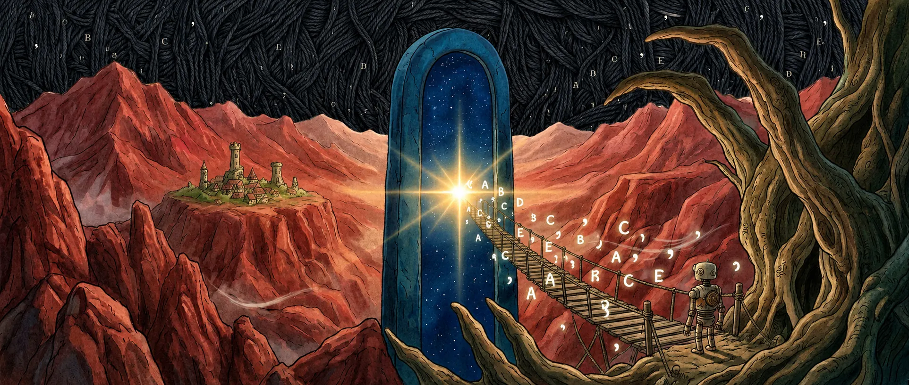

# palingenesis

<p align="center">
  
</p>

**Post-train LLMs and agents from one config: SFT, multi-turn RL in tool environments, on-policy distillation, DPO and
merging, with state-of-the-art defaults.**

[Documentation](https://mii-llm.github.io/palingenesis/) · [Quickstart](https://mii-llm.github.io/palingenesis/getting-started/quickstart/) · [Configs](configs/)

```bash
git clone https://github.com/mii-llm/palingenesis.git && cd palingenesis
uv sync --extra train --extra logging     # .venv with CUDA-enabled torch (+ --extra hybrid for Qwen3.5: faster, needed to pack)
source .venv/bin/activate
pgs train --config configs/quickstart.yaml
```

Other install paths (pip, CUDA versions, troubleshooting): [Installation](https://mii-llm.github.io/palingenesis/getting-started/install/).

## What it does

| | Command | Guide |
|---|---|---|
| **Supervised fine-tuning**, including agentic traces with tool calls and reasoning | `pgs train --config configs/quickstart.yaml` | [Data](https://mii-llm.github.io/palingenesis/guides/data/), [Agentic](https://mii-llm.github.io/palingenesis/guides/agentic-training/) |
| **Reinforcement learning**: verifiable rewards, multi-turn tool use, GRPO-style groups, vLLM rollouts | `pgs rl --config configs/rl_math.yaml` | [RL](https://mii-llm.github.io/palingenesis/guides/rl/) |
| **Agent environments**: Python classes, MCP servers, OpenEnv, NeMo Gym, Harbor tasks in Docker, with emulated harness dialects (opencode, pi, OpenHands, …) | `pgs rl --config configs/rl_harbor.yaml` | [Harbor](https://mii-llm.github.io/palingenesis/guides/harbor/), [Harness profiles](https://mii-llm.github.io/palingenesis/guides/harness-profiles/) |
| **On-policy distillation**: the student samples, one or more teachers score those tokens, reverse KL | `pgs distill --config configs/distill_math.yaml` | [Distillation](https://mii-llm.github.io/palingenesis/guides/distillation/) |
| **Preference optimization**: DPO, IPO, SLiC-HF, robust and length-normalised DPO, SFT anchor | `pgs train --config configs/dpo_qwen35_08b.yaml` | [DPO](https://mii-llm.github.io/palingenesis/guides/dpo/) |
| **Model merging**: interpolation, soups, task arithmetic | `pgs merge interpolate START END --lam 0.3 -o OUT` | [Merging](https://mii-llm.github.io/palingenesis/guides/merging/) |
| **Data preparation**: score, filter and select with the same config you train with | `pgs prepare --config configs/qwen35_4b/a100_80gb.yaml` | [Data](https://mii-llm.github.io/palingenesis/guides/data/) |
| **Autopilot**: profiles the GPU, sweeps the learning rate, trains to completion | `pgs autopilot --model Qwen/Qwen3.5-4B --dataset data.jsonl` | [Autopilot](https://mii-llm.github.io/palingenesis/guides/autopilot/) |

## Highlights

- **Correct by construction.** The loss path is checked step by step against a plain reference loop; packed conversations
  never see each other; multi-GPU gradients equal single-GPU ones; saved models load with plain `from_pretrained`.
- **Masking from the chat template itself.** Whole assistant turns are trained as the template renders them, tool calls and
  end-of-turn tokens included; `tools` are rendered into the prompt; `"loss": false` keeps a message as context only.
- **Token-exact RL.** What the trainer scores is exactly what the sampler produced, tool results included; nothing is
  re-tokenized. Rewards are checked answers, hidden tests, LLM judges or any Python function.
- **Memory.** Chunked losses (the full logits are never materialised), selective activation checkpointing, gradient
  release, 8-bit optimizers. A Qwen3.5-4B fine-tune (attention pathway, 36% of the weights) fits in about 16 GiB.
- **Long sequences on one GPU (SeCO).** Chunk-by-chunk training with a cache gives the exact gradient, verified against full
  backpropagation on 27 architectures, including the Qwen3.5 and LFM2 hybrids.
- **Training you can inspect.** wandb and trackio with grad norm, spike and clip counters, gradient noise scale, entropy and
  the generalisation gap on one step axis; best-checkpoint tracking on eval loss.
- **Crash-safe.** Re-run the same command to resume from the last complete checkpoint, in the same tracker run.
- **Scale out.** FSDP across GPUs, multi-node SLURM with sharded checkpoints, and a container image for Kubernetes.
- **Research options, one line each.** DEFT / DFT / InfoSFT token weighting, Hyperball, power-decay schedules: implemented to
  their papers' definitions; the benefits are as reported by the papers, not reproduced here.

## Hardware

| GPU | Model | Config |
|-----|-------|--------|
| A100 40 GB | Qwen3.5-4B, attention pathway (36% of weights) | `configs/qwen35_4b/a100_40gb.yaml` |
| A100 80 GB | Qwen3.5-4B, batch 4 | `configs/qwen35_4b/a100_80gb.yaml` |
| H100 80 GB | Qwen3.5-4B, FP8 | `configs/qwen35_4b/h100_80gb.yaml` |
| 8× A100 80 GB | Qwen3.5-35B MoE | `configs/qwen35_35b_moe/a100_80gb_multigpu.yaml` |

```bash
./scripts/train_multi_gpu.sh configs/qwen35_4b/a100_80gb_multigpu.yaml           # one node, all GPUs
sbatch scripts/train_slurm.sh configs/qwen35_35b_moe/a100_80gb_multigpu.yaml     # SLURM
```

Containers and Kubernetes: [docs/containers.md](docs/containers.md).

## Development

```bash
pytest tests/                 # test suite
mkdocs serve                  # docs locally (pip install mkdocs-material)
```

## License

[Apache-2.0](LICENSE).

*A new form emerging from what came before.*
