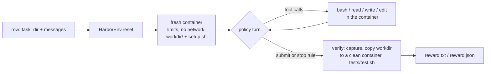

# Harbor Environments

`HarborEnv` trains and evaluates agents on **Harbor tasks**: one directory per task, a Docker container per episode, and the task's own tests as the reward. palingenesis runs the tasks itself: no Harbor installation, no external agent, no HTTP endpoint. The policy being trained is the agent, through the ordinary [environment protocol](rl.md#tools-and-environments), so every rollout is token-exact. The trainer scores exactly the tokens the sampler produced, tool calls and tool results included.

The same task directories also run under the [Harbor CLI](https://harborframework.com) with external agents (opencode, mini-swe-agent, OpenHands, ...), as long as they use upstream Harbor features only (see [Harbor CLI compatibility](#harbor-cli-compatibility)). To train a model that works well inside those real agents, see [Harness Profiles](harness-profiles.md): `HarborEnv` can reproduce each agent's prompt, tools, result wording and stop rule.



## Quick start

```bash
pgs harbor check data/harbor_tasks                # the oracle must pass, doing nothing must fail
pgs harbor rows  data/harbor_tasks data/harbor_rows.jsonl
pgs rl --config configs/rl_harbor.yaml
```

```yaml
# configs/rl_harbor.yaml (excerpt)
data:
  dataset: data/harbor_rows.jsonl     # rows {"task_dir": ".../task", "messages": [system, user]}
  prompt_field: messages
env:
  type: palingenesis.rl.envs.harbor:HarborEnv
  max_turns: 16                       # default; a row's own "max_turns" overrides it (long tasks next to short ones)
  max_concurrent: 64                  # containers alive at once
  max_tool_output_tokens: 1024
  tool_timeout: 120                   # a bash command may run tests or a build
  args: {}                            # HarborEnv arguments (below)
```

Docker must be available to the training process. Images are built once and cached, so the first episodes of a new task set wait for the build.

## Task directory

A task follows the Harbor layout:

```text
my_task/
├── task.toml            # name, limits, network, verifier settings, timeouts
├── instruction.md       # the request the agent receives (the user turn)
├── environment/
│   ├── Dockerfile       # build context ... or [environment] docker_image to reuse a prebuilt image
│   ├── workdir/         # (palingenesis) starting files, copied into the working directory
│   └── setup.sh         # (palingenesis) one-time setup after the files (a git repo, a database, services)
├── tests/
│   ├── test.sh          # the verifier: writes /logs/verifier/reward.txt or reward.json
│   └── ...              # everything else in tests/ is copied to /tests
└── solution/
    └── solve.sh         # optional oracle (used by `pgs harbor check`)
```

### task.toml

```toml
[task]
name = "org/hello"                 # "org/name" for the Harbor CLI; defaults to the directory name
description = "Write ciao into /workdir/hello.txt"   # used when instruction.md is missing

[environment]
docker_image = "my-base:1"         # optional: a prebuilt image instead of building environment/
cpus = 1                           # docker --cpus (default 1)
memory_mb = 2048                   # docker --memory (default 2048)
pids_limit = 512                   # docker --pids-limit (default 512)
allow_internet = false             # default false: --network none
workdir = "/workdir"               # the working directory (default /workdir)
build_timeout_sec = 600            # docker build timeout
env = { APP_ENV = "test" }         # container environment ($VARS expanded from the host)

[environment.healthcheck]          # optional: must succeed before the agent starts
command = "pg_isready"
retries = 10
interval_sec = 2
timeout_sec = 60

[verifier]
timeout_sec = 120                  # tests/test.sh timeout
allow_internet = false             # default: the environment's (e.g. true for an LLM judge)
capture = "python3 -I /opt/h3/capture.py /workdir"   # optional, see "Live-state capture"
capture_timeout_sec = 60
env = { EXPECTED = "ciao" }        # test environment ($VARS expanded from the host: API keys stay out of the task)

[agent]
timeout_sec = 900                  # the oracle's timeout in `pgs harbor check`

[metadata]                         # anything: difficulty, category, language, ...
```

### Starting files and setup (palingenesis extensions)

`environment/workdir/` is copied into the working directory when an episode starts, and `environment/setup.sh` runs once after it as the image's default user. This lets many small tasks share **one image**: a task set of thousands of tasks can point every `task.toml` at the same `docker_image` and differ only in `workdir/`, `setup.sh`, `instruction.md` and `tests/`. A failing `setup.sh` fails the episode start; it is never scored as the agent's failure.

### The verifier

`tests/test.sh` runs after the episode, as root in `/`, with `[verifier] env` set. It writes either:

- `/logs/verifier/reward.txt`: a number on the first line, or
- `/logs/verifier/reward.json`: `{"name": value, ...}`. Every numeric key is logged as `env/<key>`. The reward is the `reward` key (or `HarborEnv(reward_key=...)`), else the first key.

A verifier that writes nothing scores 0 and is logged as `env/metric/verifier_failed`. A verifier that crashes during `get_reward` scores 0 the same way and is logged with the task name. Two more inputs reach the tests:

| File | Content |
|---|---|
| `/logs/agent/final_message.md` | The agent's final reply (with harness profiles: the profile's answer rule). Lets the tests grade an answer ("how many ERROR lines are there?") or a question back to the user |
| `/logs/agent/capture.json` | The stdout of `[verifier] capture`, taken from the agent's live container |

## Isolation: what the verifier can trust

Each episode gets a fresh container from the task image, started with `--init`, the task's CPU, memory and PID limits, and `--network none` unless the task allows internet. The tests do **not** run in the agent's container. By default `verify` copies only the working directory into a new container from the pristine image (streamed from one `docker cp` to the other, up to 2 GiB; a larger directory scores 0) and runs the tests there. Nothing the agent left outside the working directory reaches the verifier: no background process rewriting the reward, no patched package, no `pytest.py` shadowing pytest.

### Live-state capture

Some tasks are about state a copied directory cannot carry: which processes still run, which port is listening, file owners, git internals. `[verifier] capture` is a command run **as root in the agent's container** just before the copy. Its stdout is given to the tests as `/logs/agent/capture.json`.

- A container the agent stopped (`kill -9 -1`) cannot be captured, and the episode scores 0.
- The capture runs where the policy worked, so a policy that rewrites `ps` or `python` could bias it. Call binaries by absolute paths the task does not let the agent modify, and treat captured state as evidence, not ground truth.
- Without `capture`, behaviour is unchanged.

### Container hygiene

Episode containers carry a label naming the owning host and process. The first episode of a run removes containers left behind by runs that died (a signal, OOM, a timed-out `docker rm`). On normal exit the process removes its own containers, and a container that cannot be removed right away is retried at exit.

## HarborEnv

```python
HarborEnv(
    tools=None,                 # subset of the default tools (default: all five)
    reward_key="reward",        # which reward.json key is the reward
    workdir=None,               # override the working directory (else task.toml, else /workdir)
    max_output=16000,           # characters of command output kept (head and tail, with a "characters cut" marker)
    profile=None,               # one harness profile, e.g. "opencode"
    profiles=None,              # a weighted mix, e.g. {"opencode": 1, "pi": 1, "mini-swe-agent": 1}
    profile_seed=0,             # seed of the per-group profile draw
    profile_chat_kwargs=None,   # {profile: chat_template_kwargs}, e.g. {"opencode": {"enable_thinking": True}}
    images=None,                # {task image: replacement}, e.g. {"base:1": "base:1-tmux"} for terminus-2
)
```

Without `profile`/`profiles`, the policy gets HarborEnv's own dialect (`palingenesis-default@1`):

| Tool | Behaviour |
|---|---|
| `bash(command, timeout=60)` | `bash -lc` in the working directory; returns `[exit code N]`, stdout, then `[stderr]` and stderr if any |
| `read_file(path)` | The file's text (up to 200 kB), or `Error: cannot read '<path>'` |
| `write_file(path, content)` | Creates parent directories; `Wrote <path>.` |
| `str_replace(path, old, new)` | Exact text, must occur exactly once; `Edited <path>.`, `Error: the text occurs N times in <path>; it must occur exactly once`, or `Error: old and new are identical; nothing changed in <path>` (nothing is written) |
| `submit()` | Ends the episode |

System prompt (`harbor_rows` puts it in each row; `--no-system` leaves it out): *"You work in a Linux container through tools; the working directory is /workdir and there is no internet. Inspect before you change things, check your result, then call submit and tell the user briefly what you did."*

Files the tools write belong to the image's default user, so an unprivileged image user can still change them from the shell. Relative paths resolve against the working directory.

!!! warning "Answer tasks and `submit`"
    `submit` ends the episode immediately, and the final message is the last assistant text. A model that calls `submit` before it has written its answer hands the verifier an empty reply. In a calibration run, about 70 of 3,360 answer episodes of a 27B model ended this way. For tasks graded on the reply, prefer a profile that ends on a reply without tool calls: `palingenesis-default` (= `@2`), opencode, pi or qwen-code.

### Rewards and metrics

`get_reward(messages)` returns `{"reward": r, "metric/<key>": ...}`: every reward.json component, plus with harness profiles `metric/profile/<name>` (that profile's share of the batch) and `metric/profile/<name>/reward`. They appear in the logs as `env/...`.

## Evaluating and calibrating outside training

`palingenesis.rl.episodes.run_episodes` runs episodes through the RL pipeline's own rollout loop. It uses the same prompt encoding, tool-call parsing, text protocols, harness profiles, stop rules, truncation and rewards as training, so an evaluation scores what training would see:

```python
from palingenesis.opd.rollout import Sampling, VLLMColocateRollout
from palingenesis.rl.envs.harbor import HarborEnv, harbor_rows
from palingenesis.rl.episodes import run_episodes

rows = harbor_rows("data/harbor_tasks")
groups = run_episodes(engine, tok, rows, HarborEnv, {"profiles": {"opencode": 1, "pi": 1}}, k=4,
                      temperature=Sampling(0.7, 0.8, 20), chat_template_kwargs={"enable_thinking": False},
                      max_turns=16, max_concurrent=256)
for row, group in zip(rows, groups):        # group: the k trajectories of the row
    passes = [t.reward for t in group]       # t.rewards, t.messages, t.finish, t.info["harness_profile"]
```

`engine` is any rollout engine (`VLLMColocateRollout` for vLLM in the same process, or anything with `generate(prompts, max_new_tokens, temperature)`). The `k` samples of a row share the per-group choices (the harness profile), as in training.

**Calibrate before you train.** Run the starting checkpoint with `k = 4–8` on every task and keep the tasks with `0 < pass@k < k`. Tasks that always pass or always fail give zero GRPO advantage. Run a strong model with `k = 1` on every task too, and read the per-family pass rate: a family a strong model systematically fails usually has a broken task or verifier, not a hard one.

## Checking tasks

```bash
pgs harbor check data/harbor_tasks --workers 8          # every task directory under the folder (or one task)
pgs harbor check data/harbor_tasks --json > check.json
```

For each task, `check` runs a **nop** episode (nothing done) and an **oracle** episode (`solution/solve.sh`), both through the real verifier path. A task is valid when the oracle scores 1 and the nop scores below 1. The exit code is 1 if any task is invalid. A task that passes when nothing is done is a free reward, and RL will find it.

Beyond oracle and nop, a good task set also tests **attacks** on its verifier: answers that game it, such as deleting the target instead of fixing it, or writing the expected output without doing the work. It also tests **collateral damage**: the verifier should check that nothing outside the requested change was touched. See the [data preparation guide](data.md) for difficulty selection.

## Harbor CLI compatibility

Tasks that use upstream Harbor features only (`instruction.md`, an `environment/` Dockerfile or `docker_image`, `tests/`, `solution/`, an `org/name` task name) run unchanged under the Harbor CLI (checked against harbor 0.24.0), with its agents served by an OpenAI-compatible endpoint. Use that path for evaluation or SFT data; it does not give token-exact RL trajectories.

The palingenesis extensions behave differently there:

| Extension | Under the Harbor CLI |
|---|---|
| `environment/workdir/`, `environment/setup.sh` | Not staged or run (they land as plain files) |
| `[verifier] capture` | Ignored (Harbor runs the tests in the agent's container, so the live state is already there) |
| `/logs/agent/final_message.md` | Never written: tests that grade the reply score 0 |

To publish such a task set for the CLI, convert it to Harbor's single-step `[[steps]]` layout: `steps/main/instruction.md`, `workdir/` with `workdir/setup.sh`, `solution/`, `tests/`. That layout stages the files and runs the setup. Have reply-graded tasks ask the agent to write its answer to a file the tests read, such as `/workdir/answer.txt`. Then check the converted set with the CLI itself (oracle and nop agents) before publishing. `HarborEnv` does not read the `[[steps]]` layout, so keep both: the native layout for training, `[[steps]]` for the CLI.

## Tips

- **One shared image** for a large task set: build it once, give it a versioned tag (`my-base:1`), and never retag a version while jobs use it. To change the verifier, build `my-base:2` and point the tasks at it.
- **`env.max_concurrent`** is bounded by Docker, not the GPU. Each container is cheap (`sleep infinity` plus your processes), but `docker exec` latency grows with hundreds of live containers.
- **`env.max_tool_output_tokens`** caps every observation after the tool's own truncation. With harness profiles, set it above the profiles' own limits so the policy sees the harness's wording.
- **Thinking**: `model.chat_template_kwargs: {enable_thinking: false}` for non-thinking runs. A row's own `chat_template_kwargs` wins, and with harness profiles the order is model < profile < row.
- **Held-out tasks**: split by task family and parameters, not by random rows. Near-duplicate tasks in train and dev inflate the evaluation.
